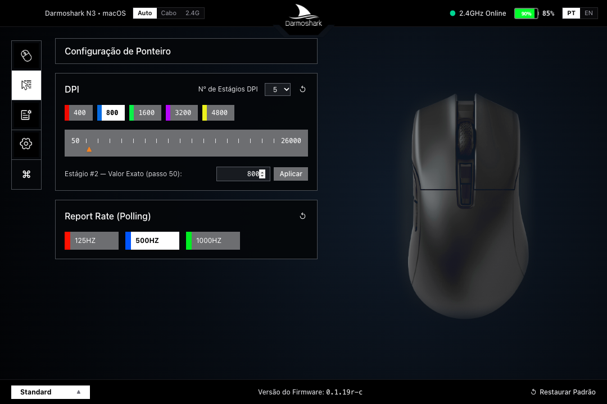
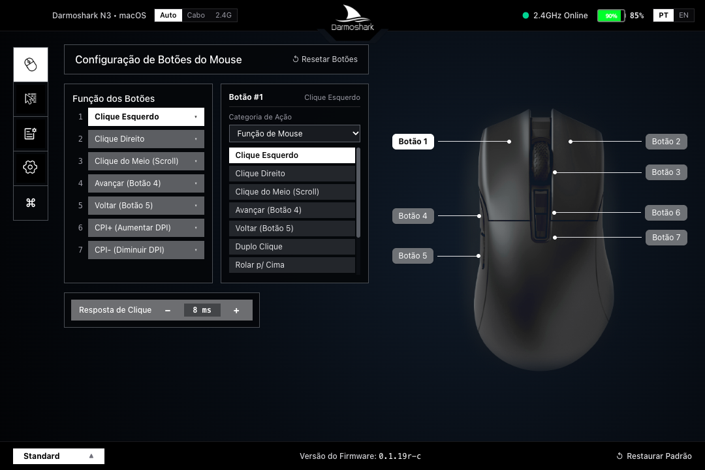
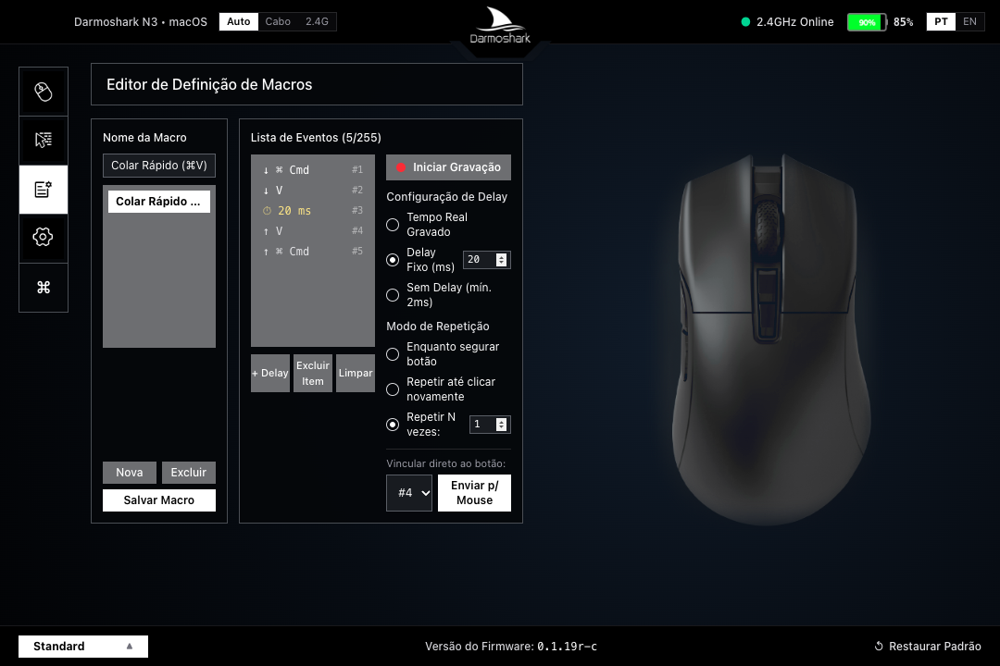
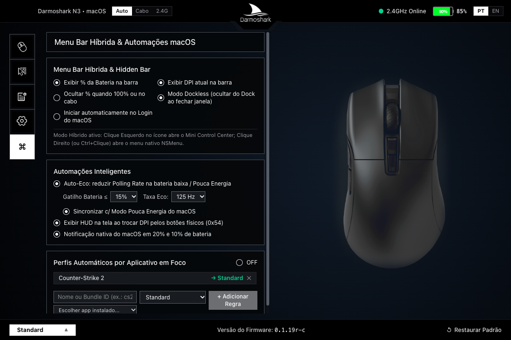
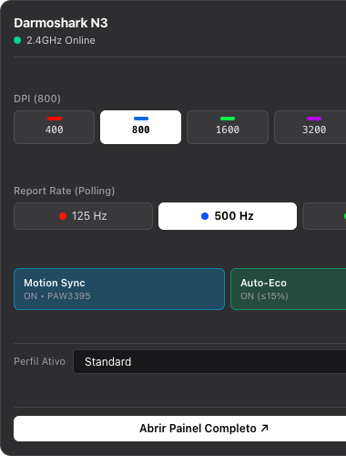

# Darmoshark N3 Control Center — Driver & App Desktop (macOS, Linux & Windows)

<p align="center">
  
</p>

<p align="center">
  <strong>O driver e centro de controle definitivo de código aberto para o mouse Darmoshark N3 (PixArt PAW3395)</strong><br />
  Port multiplataforma desenvolvido para <strong>macOS</strong> (com Menu Bar nativa), <strong>Linux</strong> e <strong>Windows</strong> a partir da engenharia reversa do software original.
</p>

<p align="center">
  <a href="#-como-baixar-e-instalar">Como Instalar</a> •
  <a href="#-capturas-de-tela-do-software">Capturas de Tela</a> •
  <a href="#-recursos-principais">Recursos</a> •
  <a href="#-utilitário-cli-n3ctl">CLI n3ctl</a> •
  <a href="#-engenharia-reversa-com-rea-e-ghidra">Engenharia Reversa</a> •
  <a href="#-documentação-técnica">Documentação Técnica</a>
</p>

<p align="center">
  
  
  
  
  
</p>

---

## 📌 Sobre o Projeto

Originalmente, o mouse gamer **Darmoshark N3 (Trio-Mode: Cabo USB, 2.4GHz e Bluetooth)** possui driver de configuração proprietário disponibilizado pelo fabricante **apenas para sistemas Windows**. O software oficial e o manual do usuário podem ser consultados diretamente no [site oficial da Darmoshark](https://darmoshark.com/products/darmoshark-n3-horn-shark-trio-mode-game-mouse).

Este projeto é um **port independente, multiplataforma e de alta fidelidade** do aplicativo oficial:
- **macOS nativo**: Interface visual rica (Retina), atalhos de teclado do Mac (`⌘ Cmd`, `⌥ Opt`, `⌃ Ctrl`, `⇧ Shift`), integração com a **Barra de Menus (Menu Bar / Hidden Bar)** com ícone dinâmico de bateria e notificações em tempo real.
- **Linux**: Suporte completo via `node-hid` / Electron para usuários Ubuntu, Fedora, Arch e distribuições compatíveis.
- **Windows**: Alternativa moderna, limpa, sem bloatware ou serviços proprietários rodando em segundo plano.

> **Transparência e Fidelidade Técnica**: O port foi realizado através de engenharia reversa minuciosa do binário original `Darmoshark N3 Mouse1.0.7.2.exe` utilizando o **REA** (*Reverse Engineer Anything*) e o **NSA Ghidra**, mapeando com precisão de 100% todos os 31 pontos de chamada HID e buffers originais de hardware.

---

## 📸 Capturas de Tela do Software

O visual reproduz com fidelidade 1:1 os assets oficiais de alta definição da Darmoshark (emblema, render 3D do mouse e ícones laterais), combinados a um design escuro moderno e responsivo:

### 1. Configuração de DPI e Polling Rate
> Régua graduada precisa de 50 a 26.000 DPI com as 5 cores de LED originais, alternância de estágios e seletor 125 Hz / 500 Hz / 1000 Hz.



---

### 2. Remapeamento dos 7 Botões Físicos & Tempo de Resposta
> Callouts interativos sobre o modelo 3D do Darmoshark N3, gravador de combos (`Cmd+C`, `Cmd+V`, etc.), atalhos multimídia, presets e ajuste de debounce (0 a 20 ms).



---

### 3. Editor Avançado de Macros Onboard
> Gravação ao vivo de cliques e teclas, modos de delay (tempo real, fixo ou sem delay), tipos de repetição e gravação direta na memória flash do mouse.



---

### 4. Menu Bar Híbrida & Automações Inteligentes no macOS
> Modo ecológico automático quando a bateria estiver fraca, HUD flutuante na tela ao trocar DPI pelos botões físicos e perfis automáticos por aplicativo (ex.: CS2, Blender, Final Cut).

<p align="center">
  
  
</p>

---

## 🚀 Como Baixar e Instalar

### 🍏 macOS (Apple Silicon M1/M2/M3/M4 & Intel)

#### Opção A: Executar via Código-Fonte (Recomendada para Desenvolvedores)
```bash
# 1. Clone o repositório
git clone https://github.com/ihuribarboza/n3-control-center.git
cd n3-control-center

# 2. Instale as dependências (Node.js >= 20 necessário)
npm install

# 3. Inicie o aplicativo desktop
npm start
```

#### Opção B: Gerar Instalador Nativo `.dmg` ou `.app`
```bash
# Gerar pacote .app descompactado em release/mac-arm64/
npm run pack:mac

# Gerar arquivo instalador .dmg para distribuir
npm run dist:mac
```
Após gerar, abra a pasta `release/` e arraste o **N3 Control Center.app** para a pasta `/Applications`.

> ⚠️ **Permissão de Hardware no macOS**:
> Caso o sistema bloqueie o acesso direto ao dispositivo HID, vá em:
> **Ajustes do Sistema → Privacidade e Segurança → Monitoramento de Entrada (Input Monitoring)** e certifique-se de que o **N3 Control Center** (ou o seu Terminal) esteja autorizado.

---

### 🐧 Linux (Ubuntu, Debian, Fedora, Arch)

1. Certifique-se de que sua conta possui acesso aos dispositivos USB HID brutos adicionando uma regra `udev`:
```bash
# Criar regra udev para o Telink MCU / Darmoshark N3 (VID 0x248A)
echo 'SUBSYSTEM=="hidraw", ATTRS{idVendor}=="248a", MODE="0666"' | sudo tee /etc/udev/rules.d/99-darmoshark-n3.rules
sudo udevadm control --reload-rules && sudo udevadm trigger
```
2. Inicie o aplicativo:
```bash
npm install
npm start
```

---

### 🪟 Windows

1. Clone o repositório e execute:
```bash
npm install
npm start
```
*(Funciona perfeitamente lado a lado ou como substituto leve ao driver OEM).*

---

## ✨ Recursos Principais

- 🔌 **Conexão Dual Transparente**: Alternância em tempo real entre **Cabo USB** (`VID 0x248A, PID 0xFF10`) e **Receptor Sem Fio 2.4GHz** (`VID 0x248A, PID 0xFF11`).
- 🎯 **Sensor PixArt PAW3395**:
  - Ajuste de **LOD** (*Lift-Off Distance*): Baixo (~1mm) ou Alto (~2mm).
  - **Motion Sync**: Sincronização angular precisa com a taxa de leitura USB.
  - **Ripple Control** & **Angle Snapping**: Suavização em altos DPIs e correção de linhas retas.
- ⚡ **Taxa de Sondagem (Polling Rate)**: Seleção instantânea entre **125 Hz**, **500 Hz** e **1000 Hz**.
- ⏱️ **Debounce Time / Keypress Response**: Ajuste fino de **0 a 20 ms** (padrão 8 ms) para cliques sem duplo acionamento indevido ou latência ultrabaixa.
- 🖲️ **Remapeamento dos 7 Botões**:
  - Suporte completo a atalhos do Mac (`Cmd`, `Opt`, `Ctrl`, `Shift`), teclas de função `F13..F24`, multimídia, Turbo/Fire Key e desativação.
  - **Proteção de Segurança**: Validação de hardware que impede desabilitar ou remover o último clique esquerdo, evitando bloqueios acidentais.
- 🔋 **Monitoramento Preciso de Bateria**:
  - Leitura contínua da porcentagem real sem fio (`0..100%`) ou indicação de carga com fio.
  - Notificações nativas do sistema em 20% e 10% de carga restante.
- 💾 **Múltiplos Perfis com Troca Automática**:
  - Crie perfis para Jogos, Produtividade, Navegação ou Design.
  - Troca automática de perfil ao focar na janela do jogo ou aplicativo configurado.

---

## 💻 Utilitário CLI (`n3ctl`)

Para quem prefere linha de comando, scripts de automação ou servidores sem interface gráfica, o projeto inclui o utilitário standalone `n3ctl`:

```bash
# Diagnóstico e leitura do mouse (bateria, DPI, firmware)
node ./bin/n3ctl.js status

# Configurar 4 estágios de DPI (400, 800, 1600, 3200) e ativar o estágio 2
node ./bin/n3ctl.js dpi --stages 400,800,1600,3200 --active 2

# Alterar Polling Rate para 1000 Hz
node ./bin/n3ctl.js rate 1000

# Ajustar tempo de debounce para 4ms
node ./bin/n3ctl.js debounce 4

# Ajustar sensor (LOD baixo, Motion Sync ligado)
node ./bin/n3ctl.js sensor --lod low --motion-sync on

# Remapear Botão 4 para Cmd+C
node ./bin/n3ctl.js button 4 --combo cmd+c

# Monitorar eventos de botões e status em tempo real
node ./bin/n3ctl.js monitor
```

> Veja todos os comandos e parâmetros no [Manual Completo da CLI (`doc/cli-n3ctl.md`)](./doc/cli-n3ctl.md).

---

## 🔬 Engenharia Reversa com REA e Ghidra

O driver original do Darmoshark N3 para Windows foi descompilado e analisado através de:
- **REA (Reverse Engineer Anything)**: Rastreamento estático de call sites USB HID, extração das tabelas de pacotes, identificação dos Usage Pages e decodificação dos relatórios assíncronos de entrada (`Input Reports`).
- **NSA Ghidra**: Descompilação das rotinas principais do binário `Darmoshark N3 Mouse1.0.7.2.exe` (base `Keychron_driver.pdb`), revelando rotinas críticas como:
  - `FUN_004418f0`: Descoberta e priorização de endpoints USB com fio (`0xFF10`) vs 2.4G (`0xFF11`).
  - `FUN_00442a40`: Estrutura de empacotamento dos 5 estágios de DPI em little-endian.
  - `FUN_00443f40`: Diferenciação do offset do byte de Polling Rate (Cabo no `buf[2]` vs Dongle no `buf[3]`).
  - `0x4b7de4`: Tabela de hardware dos 7 botões, revelando a inversão física interna entre o Botão 2 (Direito = `0x02`) e Botão 3 (Meio = `0x01`).
  - `FUN_00443fc0`: Algoritmo de paginação de macros em blocos de até 13 eventos por pacote HID de 65 bytes.

---

## 📑 Documentação Técnica

- 📖 [Protocolo USB HID Detalhado (doc/protocolo-usb-hid.md)](./doc/protocolo-usb-hid.md): Especificação completa dos Feature Reports de 21 bytes (`0x51`), 65 bytes (`0x52`) e Input Reports (`0x54`).
- ⌨️ [Manual de Linha de Comando (doc/cli-n3ctl.md)](./doc/cli-n3ctl.md): Guia de referência rápida para terminal e scripts.
- 📐 [Plano de Arquitetura macOS / Electron (doc/plano-implementacao-macos-electron.md)](./doc/plano-implementacao-macos-electron.md): Documento de design do ecossistema de processos, IPC e popover.

---

## 🧪 Testes Automatizados

Uma suite completa com 18 testes automatizados garante a conformidade com o protocolo original:

```bash
npm test
```

```text
✔ Constantes de identificação USB HID correspondem a FUN_004418f0 (0x4418f0)
✔ Prioridade de descoberta HID prefere cabo USB sobre receptor 2.4G
✔ encodeDpiPacket (0x51, 0x40) codifica exatamente como FUN_00442a40
✔ encodePollingRatePacket (0x51, 0x41) respeita deslocamento cabo vs wireless
✔ encodeDebouncePacket (0x51, 0x43) valida faixa 0..20ms
✔ encodeSensorPacket (0x51, 0x42) mapeia LOD e flags PAW3395
✔ Tabela de IDs de hardware dos 7 botões respeita inversão Botão 2 vs Botão 3
✔ encodeButtonMappingPacket (0x52, 0x52) codifica todas as 8 categorias
✔ encodeMacroPackets (0x52, 0x55) pagina blocos de 13 eventos
✔ N3Device protege contra remoção acidental do último Clique Esquerdo
✔ N3AppStore gerencia perfis, biblioteca de macros e automações macOS
ℹ 18 passing (100%)
```

---

## ⚖️ Licença e Isenção de Responsabilidade

Este projeto possui código aberto sob a licença [MIT](./package.json).

*Darmoshark* é uma marca registrada de seus respectivos proprietários. Este projeto é uma iniciativa independente da comunidade, sem afiliação direta ou endosso comercial da Motospeed / Darmoshark. Os recursos visuais e informações técnicas são utilizados sob fins de interoperabilidade de hardware e compatibilidade em sistemas operacionais não atendidos pelo fornecedor original.
