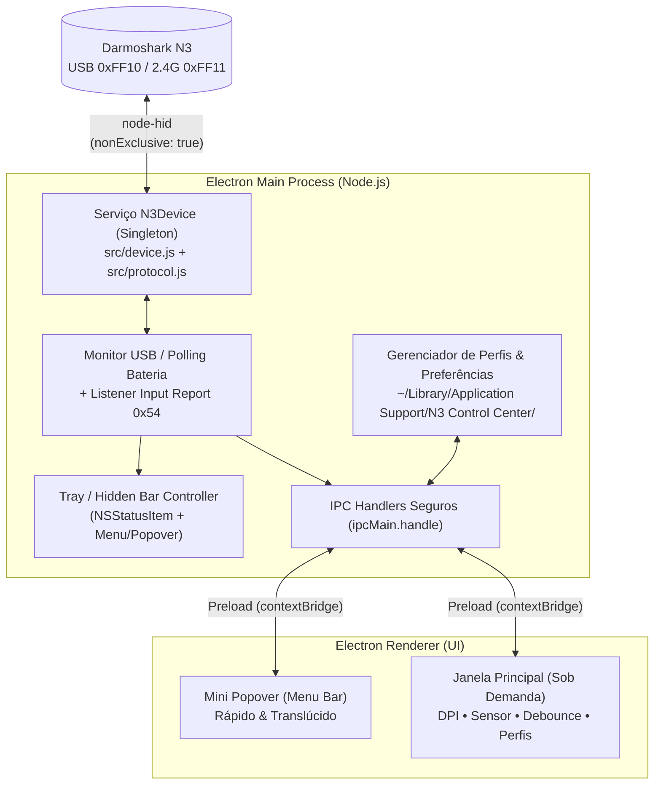

# Plano de Implementação — N3 Control Center (macOS / Electron)

> **Status do Documento:** v3 — Escopo, Menu Bar Híbrida e Automações aprovados (aguardando apenas escolha do Estilo Visual V1/V2/V3)  
> **Base de Protocolo Já Pronta (100% — 31/31 rotinas HID):** [`src/keymap.js`](../src/keymap.js), [`src/protocol.js`](../src/protocol.js), [`src/device.js`](../src/device.js) e [`src/state.js`](../src/state.js) (17/17 testes passando + validado em hardware real com firmware `0.1.19r-c`)  
> **Documentação Dedicada da CLI:** [`doc/cli-n3ctl.md`](./cli-n3ctl.md)

---

## 1. Objetivo

Construir um aplicativo desktop nativo para **macOS** em **Electron** para configurar e monitorar o mouse **Darmoshark N3** (cabo USB `0x248A:0xFF10` e receptor 2.4GHz `0x248A:0xFF11`), reaproveitando o núcleo `node-hid` já construído no projeto, com integração de primeira classe à **Menu Bar do macOS** e total compatibilidade com gerenciadores como o **Hidden Bar** (Bartender / Ice).

---

## 2. Inventário Completo de Funcionalidades do Aplicativo Original (`darmoshark.exe` v1.0.7.2)

Abaixo estão **todas** as funcionalidades encontradas na engenharia reversa do executável original Windows e de seus 146 arquivos de recursos internos (`Data1.cab`), classificadas pelo status atual do nosso protocolo USB HID:

### 2.1. Estrutura Geral, Conexão e Perfis (`IndexDlg`)

| Funcionalidade Original | Como Funciona no Windows (`darmoshark.exe`) | Status do Protocolo no Projeto | Observações para o App macOS |
| :--- | :--- | :---: | :--- |
| **Detecção Automática Cabo vs. 2.4GHz** | Prioriza cabo (`0xFF10`) se ambos estiverem plugados; monitora hotplug (`WM_DEVICECHANGE`) | **Pronto** (`0xFFC1` / `0xFFC0`) | Podemos permitir também alternar/inspecionar ambos na UI quando os dois estiverem conectados |
| **Estado Online / Sleep no 2.4GHz** | Envia ping `0x51 0x0C 0x02` e escuta `0x54 0xE2/0xE3`; bloqueia tela com *"Please connect the device"* quando em repouso | **Pronto** (`0x0C` + `0x54`) | No macOS, em vez de bloquear tudo, podemos exibir o último perfil em cache com badge *"Em repouso"* e aplicar assim que o mouse acordar |
| **Leitura de Bateria e Carga** | Sem fio: `0..100%` mapeado em 8 ícones (`power0..7`); Cabo: status de carga (`buf[12]`) + `%` (`buf[11]`) | **Pronto** (`0x06` + `0x54`) | No macOS conseguimos mostrar a `%` exata (`0..100%`) tanto no cabo quanto no 2.4GHz |
| **Leitura de Versão de Firmware** | Exibe string ASCII de 9 bytes no rodapé (ex.: `0.1.19r-c`) + versão do app | **Pronto** (`0x04`) | Exibir em *Sobre / Status do Dispositivo* |
| **Gerenciamento de 5 Perfis** | 5 arquivos locais (`profile1.ini`..`profile5.ini`, sendo o 5º rotulado `Standard`); reenvia pacotes ao trocar | **Pronto** (expansível) | No macOS podemos permitir **perfis ilimitados com nomes personalizados** + exportar/importar JSON |
| **Restaurar Padrões (`Recovery Defaults`)** | Envia `0x51 0x0B 0xAA` e restaura o `.ini` atual com o backup de fábrica | **Pronto** (`0x0B 0xAA`) | Manter com modal de confirmação seguro |
| **Idioma (`中文` / `English`)** | Alterna entre `lang_zh.ini` e `lang_en.ini` | N/A (UI) | Interface nativa em **Português (`pt-BR`)** (com Inglês opcional se desejado) |
| **Bandeja do Sistema e Auto-Start** | Flags `close` (minimizar para bandeja) e `autorun` em `config.ini` | N/A (SO) | Substituir por integração nativa macOS: **Menu Bar / Hidden Bar** + `app.dock.hide()` + *Launch at Login* |

---

### 2.2. Aba de Ponteiro, DPI e Polling Rate (`Pointer Setting`)

| Funcionalidade Original | Detalhes Técnicos | Status do Protocolo |
| :--- | :--- | :---: |
| **Quantidade de Estágios (`1..5`)** | Define quantos níveis participam do ciclo físico dos botões `CPI+`/`CPI-` (`DPINum`) | **Pronto** (`0x40`, `buf[15]` e leitura em `0x07`, `buf[17]`) |
| **Edição dos 5 Estágios de DPI** | Slider de `100` a `26.000 DPI` (passo `100`) + input numérico direto (`50..26.000` em `uint16_le`) | **Pronto** (`0x40`, `buf[5..14]` e leitura em `0x07`, `buf[6..15]`) |
| **Seleção de Estágio Ativo (`1..5`)** | Troca imediata via software + atualização ao vivo quando o usuário aperta `CPI+`/`CPI-` no mouse | **Pronto** (`0x40`, `buf[2..4]` + evento `0x54 0xE2`) |
| **Cores Indicadoras de Estágio** | 5 cores visuais na UI para identificar cada estágio | Apenas visual na UI |
| **Polling Rate (`Report Rate`)** | `125 Hz` (LED Vermelho), `500 Hz` (LED Azul), `1000 Hz` (LED Verde), com offset distinto p/ cabo (`buf[2]`) e 2.4G (`buf[3]`) | **Pronto** (`0x41` + leitura em `0x07`) |
| **Reset Individual de DPI / Polling** | Dois botões circulares de reset independentes para restaurar apenas DPI ou apenas Polling Rate | **Pronto** |

---

### 2.3. Aba de Sistema, LOD e Sensor PAW3395 (`System Function Settings`)

| Funcionalidade Original | Detalhes Técnicos | Status do Protocolo |
| :--- | :--- | :---: |
| **Altura de LOD (`Lift-Off Distance`)** | `Low` (~1 mm) ou `High` (~2 mm) | **Pronto** (`0x42`, `buf[2]`) |
| **Ripple Control** | Liga/desliga suavização de ondulação em DPIs elevados | **Pronto** (`0x42`, `buf[3]`) |
| **Angle Snap** | Liga/desliga retificação linear de movimento | **Pronto** (`0x42`, `buf[4]`) |
| **Motion Sync** | Liga/desliga sincronização dos pulsos do PAW3395 com a leitura USB | **Pronto** (`0x42`, `buf[5]`) |
| **Guia Explicativo (`?`)** | Exibe popups explicando o impacto de cada recurso do sensor | Fácil de incluir como tooltips nativos |
| **Atalho p/ Propriedades do Mouse do SO** | Abre `Control_RunDLL main.cpl` no Windows | No macOS: botão para abrir `Ajustes do Sistema → Mouse` (`x-apple.systempreferences:com.apple.Mouse-Settings.extension`) |

---

### 2.4. Aba de Botões e Debounce (`Mouse Button Setting`)

| Funcionalidade Original | Detalhes Técnicos | Status do Protocolo |
| :--- | :--- | :---: |
| **Debounce Time (`Keypress Response`)** | Ajuste fino de `0 ms` a `20 ms` (padrão `8 ms`) | **Pronto** (`0x43` + leitura em `0x07`, `buf[18]`) |
| **Mapeamento de 7 Botões Físicos** | `1: Left`, `2: Right`, `3: Middle`, `4: Avançar`, `5: Voltar`, `6: CPI+`, `7: CPI-` (`hwId = [0, 2, 1, 3, 4, 5, 6]`, com proteção obrigatória de ≥1 botão como clique esquerdo e suporte a modo canhoto) | **Pronto** (`0x52, 0x52` em `src/keymap.js` + `src/protocol.js`) |
| **Categorias de Ação por Botão** | 1. *Mouse* (cliques, duplo clique, scroll V/H) 2. *Multimídia* (volume, mudo, play/pause, faixas) 3. *Sensibilidade* (`DPI Loop`, `DPI+`, `DPI-`) 4. *Tecla / Atalho* (`Cmd/Ctrl/Opt/Shift + até 2 teclas`, 98 teclas OEM + `F13..F24`) 5. *Turbo / Fire Key* (botão + intervalo `uint16_le` ms + repetições) 6. *Atalhos de Sistema* (brilho da tela do Mac, mídia, etc.) 7. *Macro Onboard* 8. *Desativar botão* + *Reset individual dos 7 botões* (`0x51 0x0B 0x01 0x01`) | **Pronto** (`encodeButtonMappingPacket`, `encodeButtonDisablePacket`, `encodeButtonResetPacket`) |

---

### 2.5. Aba de Editor de Macros (`MacroDlg`)

| Funcionalidade Original | Detalhes Técnicos | Status do Protocolo |
| :--- | :--- | :---: |
| **Gravador e Editor de Sequências** | Até `255` eventos de 4 bytes paginados em blocos de 13 eventos por pacote de 65B (`key-down/up`, `mouse-down/up`, `delay` ms `uint16_le`, `move` relativo `int8`); modos de repetição: *enquanto pressionado* (`0x2001`), *até outra tecla* (`0x4001`) ou *N vezes* | **Pronto** (`encodeMacroPackets` + `normalizeMacroEvents` em `src/protocol.js` / `src/keymap.js`) |

---

### 2.6. Aba Oculta de Iluminação RGB (`ColorDlg`)

| Funcionalidade Original | Detalhes Técnicos | Status do Protocolo |
| :--- | :--- | :---: |
| **Modos, Cor, Brilho e Velocidade RGB** | 7 efeitos (`Off, Static, Breathing, Spectrum, Wave, Marquee, Neon`), 7 presets + RGB livre, brilho e velocidade. Oculta por padrão no N3 por ausência de fita RGB física | **Pronto** (`0x22..0x27`) — recomendado manter desativado ou recolhido em *"Opções Experimentais"* |

---

## 3. Opções para a Menu Bar / Hidden Bar do macOS

Como o **Hidden Bar** funciona posicionando divisores (`|` e `<`) na `NSStatusBar` do macOS para esconder/revelar ícones sob demanda, temos ótimas opções de design tanto para quem deixa o ícone **recolhido no Hidden Bar** quanto para quem o deixa **visível ao lado do relógio**:

### 3.1. Formato do Item na Barra Superior (`Tray` Icon & Title)

- **Opção B1 — Ícone Monocromático Minimalista (`Template Image`)**:
  - Apenas um ícone vetorial `16x16` (`@1x`/`@2x`) que segue automaticamente o modo Claro/Escuro do macOS (~22px de largura).
  - Pode mudar sutilmente de estado: ícone normal (online), ícone com raio (no cabo USB) ou ícone esmaecido/pontilhado (mouse em repouso no 2.4GHz).
- **Opção B2 — Ícone + Bateria Compacta (`85%`)**:
  - Exibe `🖱️ 85%` quando em 2.4GHz; opção inteligente de **ocultar a porcentagem automaticamente quando estiver em 100% ou no cabo** para economizar espaço na Menu Bar.
- **Opção B3 — Telemetria Customizável pelo Usuário**:
  - Permite escolher nas preferências do app o que aparece no texto ao lado do ícone:
    - `[ ] Porcentagem da bateria` (`85%`)
    - `[ ] DPI atual` (`800`)
    - `[ ] Polling rate` (`1K`)
    - `[ ] Exibir texto apenas se bateria < 25%`

### 3.2. Comportamento ao Clicar no Ícone (Menu vs. Popover)

- **Opção I1 — Menu Nativo macOS (`NSMenu`) — Ultra-leve (~0 MB de RAM extra)**:
  - Abre um menu nativo instantâneo do macOS contendo:
    - **Status**: `Darmoshark N3 • 2.4GHz Online` + `Bateria: 85%` + `Firmware: 0.1.19r-c`
    - **Troca Rápida de DPI** (radio buttons diretos): `400 DPI`, `600 DPI ✓`, `1600 DPI`, `3200 DPI`, `4800 DPI`
    - **Troca Rápida de Polling Rate** (radio buttons diretos): `125 Hz`, `500 Hz`, `1000 Hz ✓`
    - **Submenu Sensor & Debounce**: toggles rápidos para `Motion Sync`, `Angle Snap`, `Ripple Control`, `LOD (1mm / 2mm)` e presets rápidos de `Debounce (2ms / 4ms / 8ms)`
    - **Troca de Perfil**: `Perfil 1 (Trabalho)`, `Perfil 2 (FPS)`, etc.
    - Separador → `Abrir Painel Completo...` | `Iniciar com o macOS` | `Sair`
- **Opção I2 — Mini Popover Visual Estilo "Control Center" do macOS**:
  - Ao clicar no ícone (mesmo expandido temporariamente pelo Hidden Bar), abre um card flutuante com efeito translúcido nativo (`vibrancy: 'menu'`):
    - Header com nome do mouse, badge `USB` / `2.4GHz` e anel/barra de bateria.
    - Pílulas clicáveis para selecionar o estágio de DPI + valor atual em destaque.
    - Segmented control `125 Hz | 500 Hz | 1000 Hz`.
    - Toggles rápidos (`Motion Sync`, `LOD Baixo/Alto`) + dropdown de Perfil.
    - Botão de engrenagem para abrir a janela completa de ajustes avançados.
- **Opção I3 — Modo Híbrido (Recomendado)**:
  - **Clique Esquerdo**: abre o **Mini Popover Control Center** (Opção I2).
  - **Clique Direito**: abre o **Menu Contextual Nativo** (Opção I1) para troca em 1 clique ou encerrar o app.

### 3.3. Recursos Extras de Integração com o macOS

1. **Modo `Dockless` Inteligente (`app.dock.hide()`)**:
   - O aplicativo vive silenciosamente apenas na Menu Bar / Hidden Bar (sem poluir o `Cmd+Tab` nem o Dock).
   - O ícone do Dock só aparece enquanto a janela completa de configurações estiver aberta, sumindo novamente ao fechá-la (`Cmd+W`).
2. **Notificações Nativas do macOS**:
   - **Alerta de Bateria Baixa**: notificação quando o N3 cair abaixo de `20%` e `10%`.
   - **Notificação/HUD Opcional de Troca de DPI**: quando você aperta o botão físico `CPI+`/`CPI-` do mouse, o listener do Input Report `0x54 / 0xE2` detecta na hora, atualiza o ícone do menu e (opcionalmente) mostra um aviso discreto com o novo DPI.
3. **Modo Economia Automática ("Auto-Eco")** *(opcional)*:
   - Reduz automaticamente o Polling Rate para `125 Hz` ou `500 Hz` quando a bateria cair abaixo de `15%` (ou quando o Mac entrar em *Modo Pouca Energia*!).
4. **Perfis Automáticos por App em Foco** *(opcional)*:
   - Troca automaticamente para um perfil de alta performance (`1000 Hz`, `Debounce 2-4ms`) ao abrir jogos/apps específicos e retorna para perfil econômico (`125/500 Hz`) nos demais apps.
5. **Iniciar Automaticamente no Login (`Launch at Login`)**:
   - Configurável em 1 clique pelo menu da barra superior (`app.setLoginItemSettings`).

---

## 4. Arquitetura Técnica Proposta

### 4.1. Decisões Técnicas Chave para macOS + Electron + `node-hid`

1. **Acesso Único ao Hardware no `Main Process`**:
   - Todo acesso `node-hid` fica centralizado em um `DeviceService` singleton no processo principal do Electron (`contextIsolation: true`, `nodeIntegration: false` nas janelas).
   - Evita concorrência de descritores `IOHIDDevice` e mantém consumo mínimo de memória quando as janelas estão fechadas.
2. **Compatibilidade de Binário Nativo (`node-hid` no Electron)**:
   - O `node-hid@3.4.0` já usa **N-API (`napi_register_module_v1`)** via `pkg-prebuilds` (`HID-darwin-arm64` e `HID-darwin-x64`), o que significa que ele é **independente de ABI de versão do Node/Electron** (na maioria dos casos nem exige `node-gyp` para rodar no Electron em Apple Silicon / Intel!). No empacotamento final (`electron-builder`), basta declarar `asarUnpack: ["**/node_modules/node-hid/**"]`.
3. **Ciclo de Vida de Memória Zero em Background**:
   - Se a janela principal (`MainWin`) for fechada pelo usuário, ela é **destruída** (liberando o processo Chromium da janela principal) e recriada em `<150 ms` apenas quando aberta novamente.
4. **Stack de Interface (Sugestão)**:
   - **Electron + Vite + React + Tailwind CSS** (ou Vanilla/Preact ultraleve) com estética nativa macOS (Dark/Light automático, `titleBarStyle: 'hiddenInset'`, semáforos nativos do macOS, `vibrancy: 'under-window'` na sidebar).

---

## 5. Fases de Implementação Sugeridas (Roadmap)

### Fase 1 — Core Desktop + Menu Bar / Hidden Bar (MVP Completo)
- Estrutura Electron integrada aos módulos existentes (`src/protocol.js` e `src/device.js`), mantendo a CLI `n3ctl` 100% funcional no mesmo repositório.
- Ícone na Menu Bar compatível com Hidden Bar (`Template Image` + opção de exibir `%` de bateria) e modo `Dockless` (`app.dock.hide()`).
- Troca rápida pela Menu Bar (DPI, Polling Rate, LOD, Motion Sync e Perfis).
- Janela principal com estilo nativo macOS cobrindo tudo que já está 100% validado no hardware:
  - **Dashboard de Status** (conexão Cabo/2.4GHz, bateria em tempo real, firmware).
  - **Ponteiro & DPI** (1 a 5 estágios, sliders + input exato `50..26000`, seleção ativa sincronizada com os botões físicos do mouse via `0x54`).
  - **Polling Rate** (`125 / 500 / 1000 Hz` com indicação da cor do LED inferior).
  - **Clique & Sensor PAW3395** (Debounce `0..20 ms`, LOD `1mm/2mm`, Motion Sync, Angle Snap, Ripple Control).
  - **Gerenciador de Perfis** (múltiplos perfis nomeados + importação/exportação JSON + Factory Reset).

### Fase 2 — Automações macOS & Polimento `.app` / `.dmg`
- Notificações nativas de bateria baixa e HUD opcional ao trocar DPI pelos botões físicos.
- *Launch at Login*, modo *Auto-Eco* (reduzir polling rate em bateria fraca ou Modo Pouca Energia do macOS) e perfis automáticos por app ativo (se desejado).
- Empacotamento em `N3 Control Center.app` / `.dmg` pronto para arrastar para `/Applications`.

### Fase 3 — Interface Visual de Botões e Editor de Macros (`Report ID 0x52` já pronto no Core!)
- Como o protocolo `0x52` (`0x52` e `0x55`) já está 100% codificado e testado em [`src/keymap.js`](../src/keymap.js) e [`src/protocol.js`](../src/protocol.js), basta construir as telas visuais no Electron:
  - **Mapa Interativo dos 7 Botões** com captura de atalhos do macOS (`Cmd`, `Opt`, `Ctrl`, `Shift`, `F13..F24`, Multimídia, Turbo e Desativar).
  - **Gravador / Editor Visual de Macros** com timeline de eventos e modos de loop (`count`, `hold`, `toggle`).

---

## 6. Decisões Já Confirmadas vs. Escolha Visual Final

### 6.1. Decisões Aprovadas
- **Escopo Completo na v1**: inclui **DPI & Polling Rate**, **Sensor PAW3395 & LOD**, **Debounce (`0..20 ms`)**, **Remapeamento dos 7 Botões (`0x52, 0x52`)**, **Editor/Gravador de Macros Onboard (`0x52, 0x55`)** e **Perfis**.
- **Sem RGB na Interface Gráfica**: aba RGB **excluída da UI** (mantendo o aplicativo enxuto e fiel ao hardware físico do N3; comandos RGB permanecem apenas na CLI `n3ctl rgb` para diagnóstico).
- **Menu Bar / Hidden Bar em Modo Híbrido**:
  - **Clique Esquerdo**: abre o **Mini Popover estilo Control Center**.
  - **Clique Direito**: abre o **Menu Nativo `NSMenu`** do macOS.
  - **Texto ao lado do ícone configurável**: toggles independentes para exibir **`%` da Bateria** e/ou **`DPI` atual** (com opção inteligente de ocultar `%` em 100% ou no cabo, se desejar).
- **Todas as 5 Automações macOS Incluídas**:
  1. Alerta nativo de bateria baixa (`20%` e `10%`).
  2. HUD / Notificação ao alternar estágio de DPI pelos botões físicos (`0x54 / 0xE2`).
  3. Modo **Auto-Eco** (reduz Polling Rate automaticamente em bateria fraca ou *Modo Pouca Energia* do macOS).
  4. **Perfis automáticos por aplicativo em foco** no macOS (jogos vs. trabalho).
  5. *Iniciar no login* (`Launch at Login`) + modo `Dockless` (`app.dock.hide()`).
- **Convivência com a CLI**: `n3ctl` mantida no mesmo repositório compartilhando `src/`, documentada em [`doc/cli-n3ctl.md`](./cli-n3ctl.md).

### 6.2. Última Definição Antes de Iniciarmos o Código
Escolha no protótipo visual interativo qual direção prefere:
1. **Estilo Visual**:
   - **Réplica 1:1 da UI Original Darmoshark N3 (Retina macOS)**: usa os gráficos oficiais extraídos do `Data1.cab` (emblema Darmoshark, coluna de ícones quadrados originais, foto 3D real do N3 com linhas de *callout* dos 7 botões, régua cinza com triângulo laranja e botões `125HZ / 500HZ / 1000HZ` vermelho/azul/verde), mas renderizando fontes e bordas em alta definição Retina no macOS (`PT-BR` / `EN`), sem RGB e com o 5º botão quadrado lateral (`⌘`) para Automações macOS & Menu Bar.
   - *(Alternativas anteriores caso queira comparar: V1 macOS Nativo Clean, V2 Tactical Stealth ou V3 Bento).*
2. **Stack do Renderer**:
   - **Stack A (Recomendada)**: `Electron + Vite + React + Tailwind CSS 4`
   - **Stack B (Alternativa 3 KB)**: `Electron + Vite + Preact + Tailwind CSS 4`
